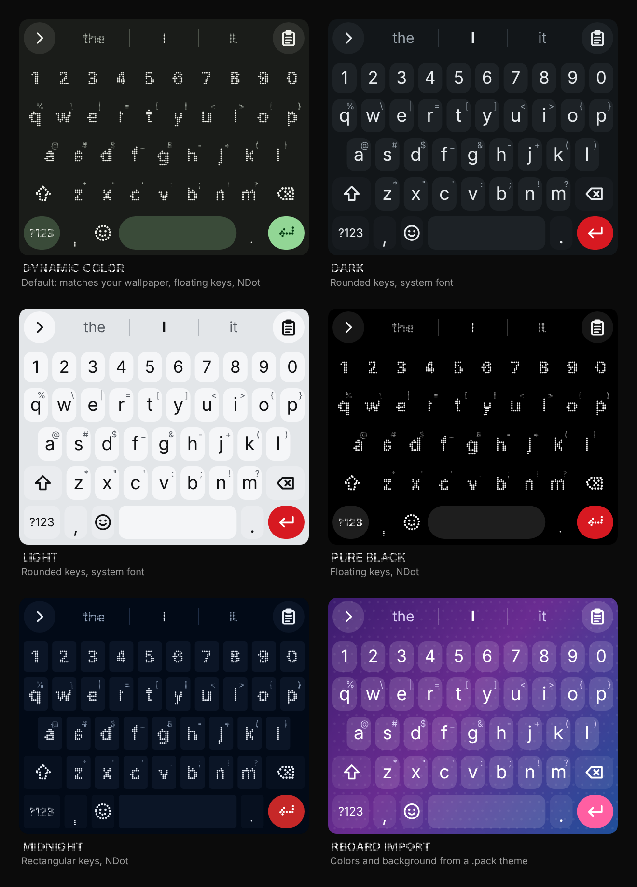
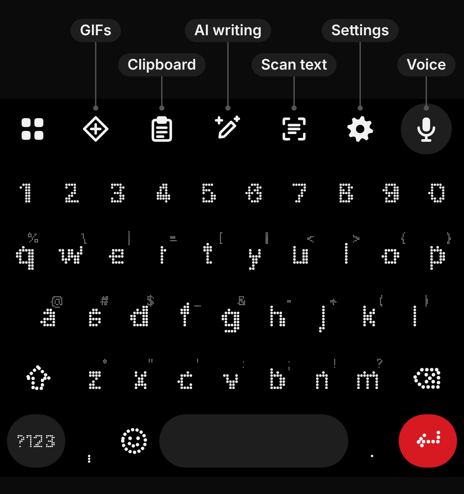
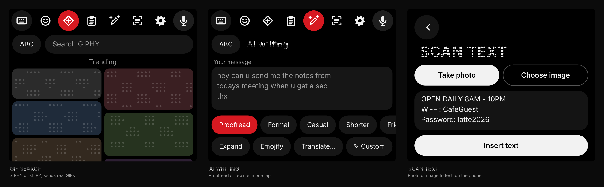
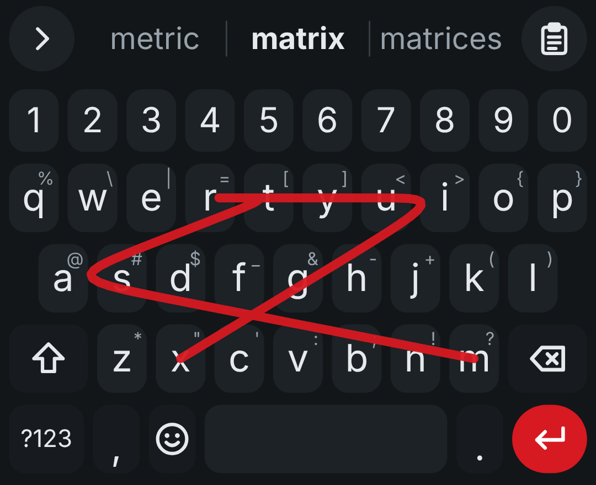
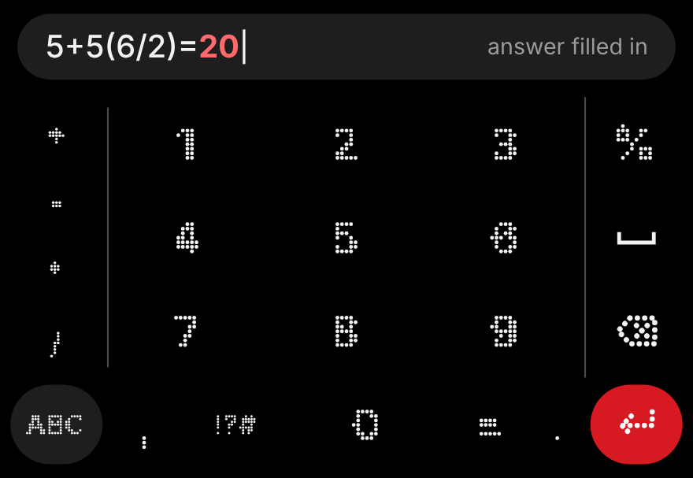
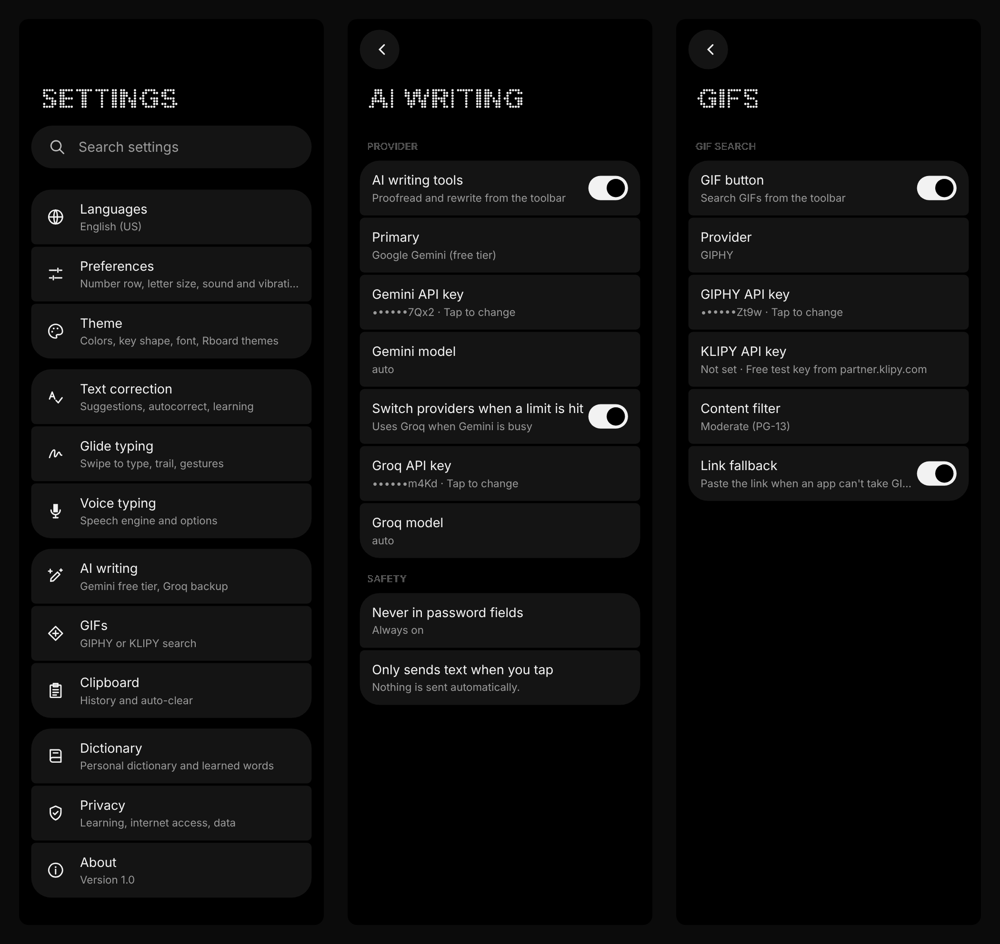

# Matrix Key

A dot-matrix keyboard for Android, built for Nothing phones. It has Gboard-level features and offline learning, plus free AI writing and GIF search.

## Install

1. On your phone, open **[Releases](../../releases/latest)** and download `MatrixKey-*.apk`.
2. Open the file and allow installing from your browser or Files app if Android asks. Requires Android 10+ on a 64-bit phone.
3. Open **Matrix Key**, then follow the setup steps at the top: turn it on, switch to it, and allow the microphone.
4. Optionally check the download: each release lists the APK's SHA-256 and the signing certificate's fingerprint, which is the same for every release.

## Themes

Open **Settings › Theme** to choose, with a live preview and Cancel / Apply:

- **Colors:** Dynamic Color (follows your wallpaper, the default), System Auto, Light, Dark, Pure Black and Midnight.
- **Key shape:** Rounded, Rectangular, or **None** for floating letters.
- **Key font:** Nothing's **NDot** when your phone has it (otherwise the open-source *Doto* dot-matrix font), the system font, or a font file you import.
- **Accent color:** automatic, or pick your own.
- **Rboard / Gboard themes:** import a `.pack` file, no root needed. Its colors and background image are mapped onto Matrix Key.

## Toolbar

Tap the **grid** button at the top left to switch between the toolbar and word suggestions. **Swipe down** on the toolbar or suggestion bar to put the keyboard away. When a panel is open, the same button (now a keyboard) takes you back to the keys.

| Button | What it does |
|---|---|
| **Emoji** | Opened from the smiley key next to the space bar (the toolbar only gets an emoji button if you turn that key off). Recent emoji, categories, and a **search bar**: type "heart", "thumbs up" or "lol" and tap a result |
| **GIFs** | Search and send GIFs (needs a free key, see below) |
| **Clipboard** | Clipboard history with pinning and auto-clear; skips passwords and one-time codes |
| **AI writing** | Proofread or rewrite your message (needs a free key, see below) |
| **Scan text** | Take a photo or pick an image and insert the text in it |
| **Settings** | Opens Matrix Key's settings |
| **Voice** | Voice typing with your phone's speech recognizer |

## Typing

- **Suggestions and autocorrect** that know which keys are next to each other. The bar scrolls sideways for more suggestions, and long words are never shrunk.
- **Glide typing** with a trail in your accent color (dotted with NDot). Your own dictionary words win close calls. **Double letters:** draw a small loop on the letter (o → loop on f for *off*).
- **Spacebar cursor:** slide on the spacebar to move the cursor, with a haptic tick for every letter.
- **Delete words:** swipe left from backspace to select whole words, then let go to delete them.
- **Proofreading:** tap any word in your text to get its suggestions back and swap it.
- **Learns on your phone only:** your words and names, the typos you tend to make, your corrections, and where your thumbs land on each key.
- **Personal dictionary:** add names, slang or your email in *Settings › Dictionary*. They show up as you type or swipe.
- Number row, symbol hints, long-press for accents, one-handed mode, adjustable height and letter size, sound and vibration.

- **Number pad:** the **1234** key on the symbols page opens a calculator-style pad.
- **Quick math:** type a sum and then `=`, and the answer is filled in. `5+5(6/2)=` gives `20`. Percentages work like a shop calculator: `50+10%=` gives `55`.

## Settings

Settings follow Nothing's style: a dot-matrix title, a **search bar** that finds any option, and grouped tiles.

| Page | Options |
|---|---|
| **Languages** | Keyboard layout (QWERTY, QWERTZ, AZERTY, Dvorak, Colemak) |
| **Preferences** | Number row, symbol hints, dot-matrix icons, emoji key, toolbar, one-handed mode, letter size, keyboard height, sound, vibration strength, key popups, long-press delay |
| **Theme** | Colors, key shape, font, accent, Rboard import |
| **Text correction** | Suggestion strip, next-word and emoji suggestions, offensive-word filter, autocorrect, learning, touch-aim learning, auto-capitals, double-space period |
| **Glide typing** | Swipe to type, trail style, thickness and color, backspace swipe, spacebar cursor with haptic ticks |
| **Voice typing** | On/off, speech engine, auto-punctuation, microphone permission |
| **AI writing** | Gemini and Groq keys, primary provider, models, automatic switching |
| **GIFs** | GIPHY or KLIPY, API keys, content filter, link fallback |
| **Clipboard** | History, auto-clear, hide passwords and codes, pinned items |
| **Dictionary** | Your words and learned words; add, remove, import and export |
| **Privacy** | Incognito in private tabs, internet access, reset learned data, delete all keyboard data |
| **About** | Version, privacy in brief, credits and links |

## Set up GIF search

GIFs need a free API key from **GIPHY** or **KLIPY**. You only do this once.

**GIPHY** (easiest)
1. Go to [developers.giphy.com](https://developers.giphy.com/dashboard/) and sign up or log in.
2. Tap **Create an API Key** (or **Create an App**) and choose **API**, not SDK.
3. Give it a name, such as *Matrix Key*, and a short description, accept the terms, and create it.
4. Copy the **API key** that appears. It's a free beta key.
5. In Matrix Key, open **Settings › GIFs**, set **Provider** to **GIPHY**, tap **GIPHY API key**, paste and tap **OK**.

**KLIPY** (alternative)
1. Go to [partner.klipy.com](https://partner.klipy.com), sign up, and create an app to get a free test key.
2. If it asks for your platform or website, enter `https://github.com/m0n0t0ne0ne/Matrix-Key`.
3. Copy the key, then in **Settings › GIFs** set **Provider** to **KLIPY** and paste it into **KLIPY API key**.

**Using it:** tap the **GIF** button in the toolbar, tap the search bar and type (or swipe), then tap a GIF to send it. If an app can't accept GIFs, Matrix Key pastes the link instead (*Link fallback*). *Content filter* sets how strict results are.

## Set up AI writing

AI writing uses **Google Gemini's free tier**, with **Groq's free tier** as an optional backup for when Gemini is busy or you hit its limit.

**Gemini** (main)
1. Go to [aistudio.google.com/apikey](https://aistudio.google.com/apikey) and sign in with your Google account.
2. Tap **Create API key**, then copy it.
3. In Matrix Key, open **Settings › AI writing**, tap **Gemini API key**, paste and tap **OK**. Leave **Gemini model** on `auto`; it picks the best available model.

**Groq** (backup, optional)
1. Go to [console.groq.com/keys](https://console.groq.com/keys) and sign in.
2. Tap **Create API Key**, give it a name, and copy it right away. It's only shown once.
3. In **Settings › AI writing**, paste it into **Groq API key** and keep **Switch providers when a limit is hit** on.

**Using it:** type your message (or select part of it), tap the **AI** button, and pick **Proofread**, **Formal**, **Casual**, **Shorter**, **Friendlier**, **Expand**, **Emojify**, **Translate…** or **✎ Custom**. Check the result, then tap **Replace**, **Try again** or **Back**.

Nothing is sent until you tap an action, and AI writing never runs in password fields. On the free tiers, Google and Groq may use what you send to improve their models, so don't use it for anything private.

## Scan text

Tap the **Scan text** button, then **Take photo** or **Choose image**. The text is read on your phone and never uploaded. Edit it if you need to, then tap **Insert text** to type it where you were. Scan text uses Google Play services' text reader; the first time, your phone may take a minute to download it.

## Privacy

- Typing, learning, your dictionary and clipboard history stay on the phone. They're excluded from backups and from transfer to a new phone.
- Permissions: internet (GIFs and AI writing only), vibration, and the microphone, which is optional and only for voice typing.
- Every network request is HTTPS and goes straight to the provider you chose, using your own key.
- The keyboard doesn't learn in password fields or fields that ask for no personalization, such as incognito tabs.
- See [SECURITY.md](SECURITY.md) for the full details.

## Building it yourself

- Requires JDK 17 and the Android SDK (API 35).
- Run `./gradlew assembleRelease`. Without a key, the build is signed with your debug key.
- To sign with your own key, set `KEYSTORE` (path to a `.jks`) and `KEYSTORE_PASS` (its password; key alias `matrixkey`).
- The build downloads the Doto font (SIL OFL 1.1) and an English word-frequency list ([FrequencyWords](https://github.com/hermitdave/FrequencyWords), CC BY-SA 4.0) into `app/src/main/assets`.

### Releases

Releases are built and signed by GitHub Actions, never on a personal machine:

- **Build check** (`.github/workflows/ci.yml`) builds every push and pull request. Nothing is published.
- **Release** (`.github/workflows/release.yml`): running it from the Actions tab, or pushing a tag such as `v1.0`, builds that exact commit, signs it with the key stored in the repository's encrypted secrets (`KEYSTORE_BASE64`, `KEYSTORE_PASS`), and publishes the release with the APK, its SHA-256 and the signing certificate's fingerprint. Release notes come from `docs/release-notes/<tag>.md`.

To release: bump `versionCode` and `versionName` in `app/build.gradle.kts` and add the notes file, then run **Actions › Release › Run workflow** (it tags the current `main` commit as `v<versionName>`), or push that tag.

## Security and licence

See [SECURITY.md](SECURITY.md) for how to report a problem and how releases are signed.

The code in this repository is released under the [MIT Licence](LICENSE) and comes with no warranty. Fonts, the word list and libraries keep their own licences; see [THIRD-PARTY-NOTICES.md](THIRD-PARTY-NOTICES.md). Unofficial app, not affiliated with Nothing.
